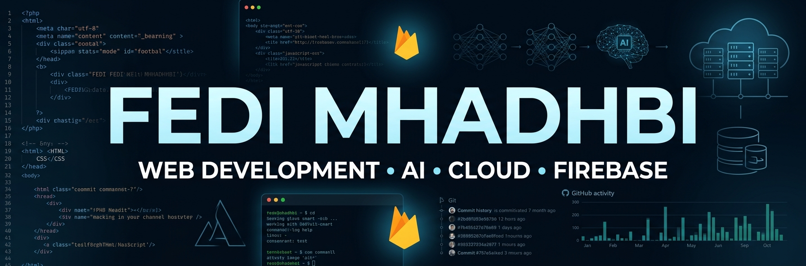

  

<h1 align="center">Hi 👋, I'm Fedi Mhadhbi</h1>

  

---

## 👨‍💻 About Me

I'm **Fedi Mhadhbi**, a Business Computing student and web developer from Tunisia 🇹🇳.

I enjoy building practical web applications and exploring technologies that can solve real-world problems. My current interests include **web development, Artificial Intelligence, cloud technologies, Firebase, and Linux**.

* 🌐 Building full-stack web applications
* 🤖 Exploring Artificial Intelligence
* ☁️ Learning about cloud technologies and Firebase
* 🐧 Comfortable working with Linux and the command line
* 🚀 Building projects focused on real-world problems
* 🇹🇳 Based in Tunisia

---

## 🛠️ Tech Stack

### 💻 Web Development

  

### 🗄️ Backend & Databases

  

### 🤖 Programming & AI

  

### ☁️ Tools & Platforms

  

---

## 🚀 Featured Projects

### 🌐 Nour — Tunisia Outage Map

A collaborative real-time web platform designed to help people across Tunisia report and monitor electricity and water outages.

**Key features:**

* 🗺️ Real-time outage map
* ⚡ Electricity and water outage reports
* 📍 Location-based reporting
* 🧩 Nearby report clustering
* 🔄 Mixed-status detection
* 🚨 Emergency alert functionality
* 📱 Progressive Web App

🔗 **Repository:** https://github.com/Fedi-Mhadhbi/nour-outage-map

---

### 🇹🇳 TunCover

A full-stack web platform designed to promote Tunisian tourism, culture, local artisans, and authentic experiences.

**Key features:**

* 🗺️ Tourism and experience discovery
* 🎨 Artisan profiles and cultural content
* 📅 Booking and reservation management
* 💳 Simulated payment workflow
* 👤 Role-based user functionality
* 📱 Progressive Web App

🔗 **Repository:** https://github.com/fedimh666/tuncover

---

## 📊 GitHub Statistics

  

  

---

## 📈 Contribution Streak

  

---

## 🌐 Connect With Me

  

---

  <i>Building, learning, and turning ideas into real projects. 🚀</i>

